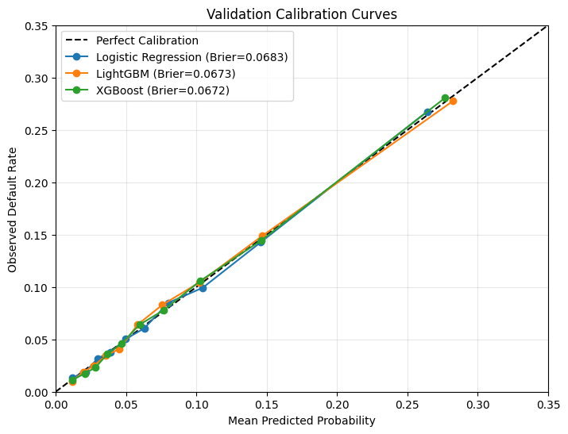
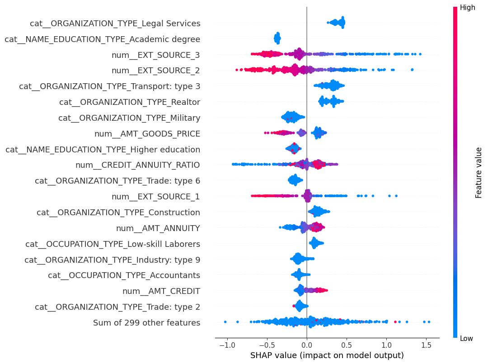
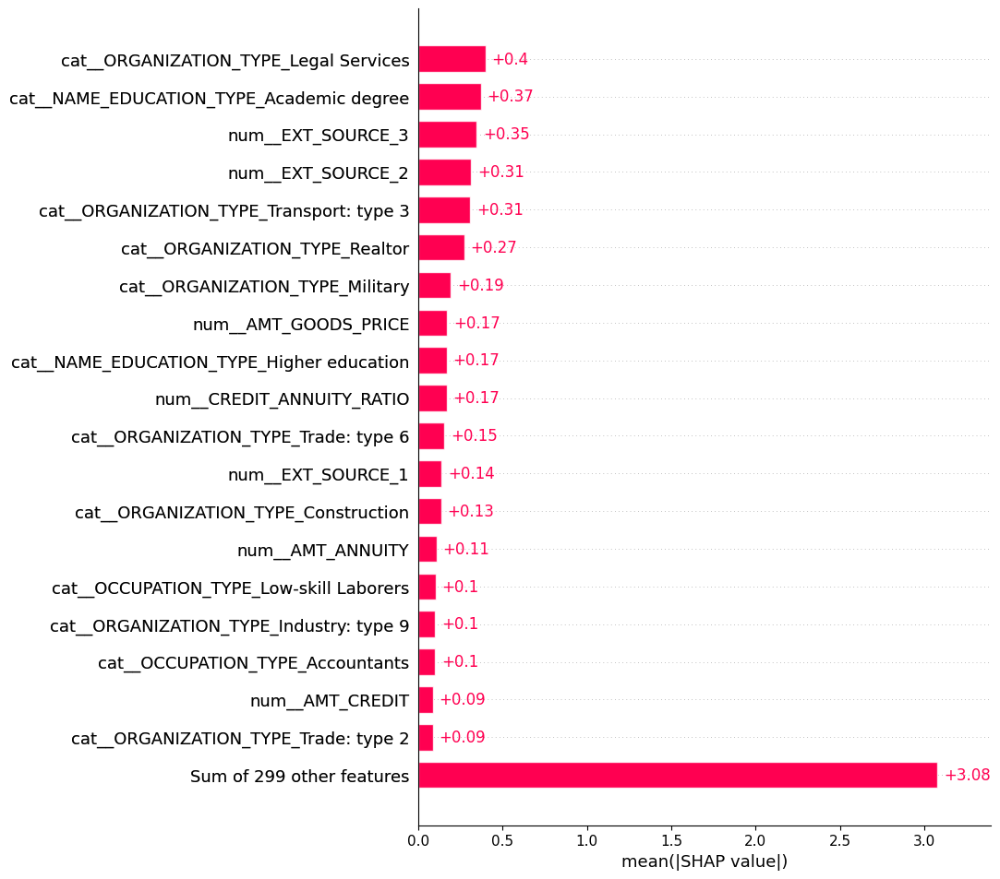
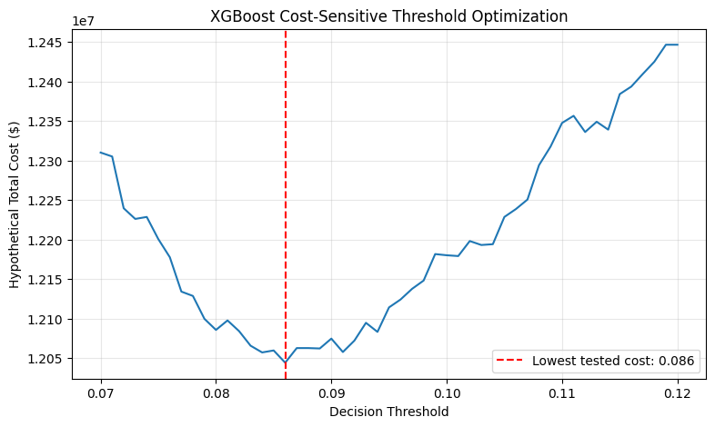
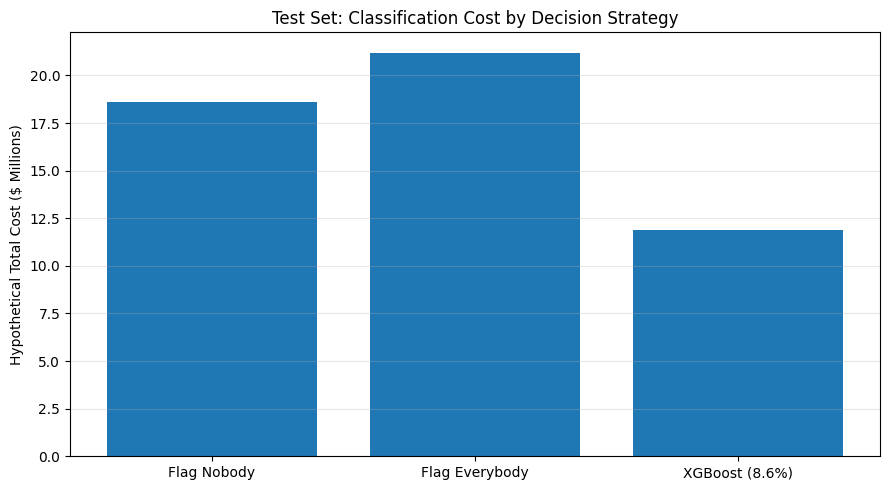

# Credit Risk Prediction & Cost-Sensitive Decision Optimization

### End-to-End Machine Learning | Financial Risk Analytics | Explainable AI

## Project Overview

This project develops an end-to-end machine learning pipeline to predict borrower repayment difficulties using the **Home Credit Default Risk** dataset.

The objective is not only to predict credit risk accurately, but also to explore how predicted probabilities can support financial decision-making when different classification errors have different costs.

The project compares **Logistic Regression, Random Forest, LightGBM, and XGBoost**, evaluates probability calibration and model interpretability, and optimizes a decision threshold under hypothetical financial costs.

The final XGBoost model achieved a **0.7691 ROC-AUC** on the untouched test set and reduced hypothetical classification costs by **36.16%** relative to flagging no borrowers.

## Key Results

| Metric | Final Test Result |
|---|---:|
| ROC-AUC | **0.7691** |
| PR-AUC | **0.2546** |
| Brier Score | 0.0672 |
| Precision | 17.82% |
| Recall | **67.11%** |
| F1-Score | 0.2816 |
| Selected Decision Threshold | 8.6% |
| Hypothetical Cost Reduction | **36.16%** |

**Key takeaway:** By combining probability-based risk predictions with cost-sensitive decision optimization, the selected XGBoost strategy identified approximately 67% of borrowers who experienced repayment difficulties while reducing simulated classification costs relative to simple baseline strategies.

*All reported cost reductions are based on hypothetical assumptions and do not represent realized financial savings.*

---

## Dataset

**Source:** [Home Credit Default Risk — Kaggle](https://www.kaggle.com/competitions/home-credit-default-risk)

The primary application dataset contains **307,511 borrower observations**, with approximately **8.07%** labeled as experiencing repayment difficulties.

The dataset includes borrower demographics, financial characteristics, employment information, loan characteristics, and external credit-related scores.

### Data Splitting

The dataset was divided into stratified training, validation, and test sets:

| Dataset | Observations | Purpose |
|---|---:|---|
| Training (70%) | 215,257 | Model training |
| Validation (15%) | 46,127 | Model selection and threshold optimization |
| Test (15%) | 46,127 | Independent final evaluation |

The test dataset was kept untouched until the final model and decision threshold had been selected.

---

## Methodology

### 1. Exploratory Data Analysis

Investigated class imbalance, missing values, borrower characteristics, financial variables, and relationships with repayment difficulties.

Key areas of analysis included:

- Borrower age and employment duration
- Income, credit amounts, and loan annuities
- External credit-related scores
- Missing-data patterns
- Relationships between financial characteristics and repayment difficulties

### 2. Feature Engineering and Preprocessing

Engineered additional borrower and financial features, including:

- Age and employment duration
- Employment anomaly indicators
- Credit-to-income ratio
- Annuity-to-income ratio
- Credit-to-annuity ratio

Preprocessing included numerical imputation, categorical encoding, missingness indicators, and numerical scaling.

Transformations were fitted using training data only to prevent data leakage.

### 3. Model Development

Four machine learning approaches were evaluated:

- **Logistic Regression:** Interpretable linear baseline
- **Random Forest:** Ensemble tree-based baseline
- **LightGBM:** Gradient boosting with efficient tree construction
- **XGBoost:** Regularized gradient boosting

Hyperparameter tuning was performed on the boosting models.

The final XGBoost configuration was selected based on validation performance, including PR-AUC, ROC-AUC, and probability calibration.

Performance differences between the tuned XGBoost and LightGBM models were small.

---

## Model Performance

### Validation vs. Test Performance

| Metric | Validation | Test |
|---|---:|---:|
| ROC-AUC | 0.7661 | **0.7691** |
| PR-AUC | 0.2566 | **0.2546** |
| Brier Score | 0.0672 | **0.0672** |
| Precision at 8.6% | 17.52% | **17.82%** |
| Recall at 8.6% | 66.73% | **67.11%** |

The close alignment between validation and test performance suggests that the selected model generalizes reasonably well to unseen observations drawn from the same data distribution.

### Probability Calibration

In addition to ranking borrowers by risk, credit risk models benefit from producing meaningful probability estimates.

Calibration was evaluated by comparing predicted repayment-difficulty probabilities with observed event rates across probability bins.



The final XGBoost model achieved a **test Brier score of 0.0672**, indicating performance similar to that observed during validation.

Calibration assessment is particularly relevant because predicted probabilities are subsequently used to make cost-sensitive decisions.

---

## Model Interpretability

SHAP (SHapley Additive exPlanations) was used to investigate how individual features contribute to XGBoost predictions.

### SHAP Summary Plot



The SHAP summary plot illustrates both the magnitude and direction of feature contributions.

External credit-related scores, particularly `EXT_SOURCE_2` and `EXT_SOURCE_3`, emerged as important predictors of repayment difficulties.

Lower values of these scores were generally associated with increased predicted risk.

### SHAP Feature Importance



The feature importance plot summarizes the average absolute SHAP contribution of each feature across sampled observations.

Together, these visualizations help explain the model's predictions and provide insight into the factors influencing estimated borrower risk.

SHAP values describe model behavior and should not be interpreted as causal effects.

---

## Cost-Sensitive Threshold Optimization

Traditional binary classification often uses a default probability threshold of 0.50.

However, credit risk decisions involve asymmetric consequences: failing to identify a borrower who experiences repayment difficulties may be more costly than incorrectly flagging a borrower who does not.

To explore this trade-off, hypothetical classification costs were assigned:

| Classification Error | Assumed Cost |
|---|---:|
| False Positive | $500 |
| False Negative | $5,000 |

Total classification cost was calculated as:

**Total Cost = (False Positives × $500) + (False Negatives × $5,000)**

### Threshold Optimization Results



Decision thresholds were evaluated on the validation dataset to identify the threshold minimizing hypothetical classification costs.

The selected threshold was **0.086 (8.6%)**, with a validation classification cost of **$12,044,000**.

This threshold prioritizes identifying borrowers at risk of repayment difficulties while balancing the increased number of false-positive classifications.

The decision threshold was frozen before final test evaluation.

---

## Business Impact

The final XGBoost decision strategy was compared against two simple classification baselines on the untouched test dataset.

### Classification Cost Comparison



| Decision Strategy | Hypothetical Test Cost | Reduction vs. Flag Nobody |
|---|---:|---:|
| Flag Nobody | $18,620,000 | 0.00% |
| Flag Everybody | $21,201,500 | -13.86% |
| **XGBoost (8.6%)** | **$11,886,500** | **36.16%** |

Using the selected decision threshold, the XGBoost model achieved a **36.16% reduction in hypothetical classification costs** relative to flagging no borrowers.

This corresponds to approximately **$6.73 million in simulated cost avoidance** across the test dataset under the specified assumptions.

### Final Classification Results

| Outcome | Test Observations |
|---|---:|
| True Positives | 2,499 |
| True Negatives | 30,880 |
| False Positives | 11,523 |
| False Negatives | 1,225 |

At the selected threshold, the model identified **67.11% of borrowers who experienced repayment difficulties**.

The relatively low precision of 17.82% reflects the trade-off associated with prioritizing recall in an imbalanced classification problem.

**Business takeaway:** Predictive performance alone does not determine the usefulness of a risk model. Translating probabilities into decisions requires considering the relative consequences of different errors.

*The cost assumptions are hypothetical and do not incorporate actual exposure at default, loss given default, loan profitability, or institution-specific lending policies. The results should not be interpreted as realized financial savings.*

---

## Repository Structure

```text
credit-risk-prediction/
|
|-- notebooks/
|   |-- 01_eda.ipynb
|   |-- 02_preprocessing.ipynb
|   |-- 03_modeling.ipynb
|   |-- 04_evaluation.ipynb
|   |-- 05_final_results.ipynb
|
|-- images/
|   |-- calibration.png
|   |-- shap_summary.png
|   |-- shap_importance.png
|   |-- threshold_optimization.png
|   |-- business_impact.png
|
|-- README.md
|-- .gitignore
```

### Notebook Overview

| Notebook | Description |
|---|---|
| `01_eda.ipynb` | Exploratory analysis of borrower characteristics, repayment difficulties, and missing data |
| `02_preprocessing.ipynb` | Feature engineering, preprocessing, and train-validation-test splitting |
| `03_modeling.ipynb` | Model development, comparison, and hyperparameter tuning |
| `04_evaluation.ipynb` | Calibration, SHAP interpretability, risk ranking, and threshold optimization |
| `05_final_results.ipynb` | Independent test evaluation and business impact analysis |

---

## Tools and Technologies

**Programming:** Python

**Data Analysis:** Pandas, NumPy, SciPy

**Machine Learning:** scikit-learn, LightGBM, XGBoost

**Explainability:** SHAP

**Visualization:** Matplotlib

**Development Environment:** Google Colab, Jupyter Notebook, Google Drive

---

## Limitations and Future Work

Although the model demonstrated consistent performance across validation and test datasets, several limitations should be considered.

**Historical data and generalization:** The dataset represents historical lending observations. A random holdout split does not establish performance under future economic conditions or changing borrower populations.

**Hypothetical cost assumptions:** The classification costs are illustrative and do not incorporate actual loan exposure, recovery rates, or lending profitability.

**Fairness and compliance:** The dataset contains demographic and potentially sensitive variables. Additional fairness analysis and regulatory review would be necessary before considering real-world credit decision applications.

**Probability estimation:** The target represents the dataset's repayment-difficulty outcome and should not automatically be interpreted as a formal regulatory definition of default.

### Potential Extensions

- Evaluate model stability using temporal or out-of-time validation.
- Incorporate supplementary Home Credit datasets to improve predictive performance.
- Explore expected-loss modeling using probability of default, loss given default, and exposure at default.
- Assess fairness and potential disparate impact across borrower groups.
- Investigate model monitoring, data drift, and recalibration.

---

## Conclusion

This project demonstrates an end-to-end approach to credit risk prediction that integrates **machine learning, probability evaluation, explainable AI, and cost-sensitive decision optimization**.

The final XGBoost model achieved a test ROC-AUC of **0.7691** and identified **67.11%** of borrowers experiencing repayment difficulties at the selected decision threshold.

Under hypothetical misclassification costs, the resulting decision strategy reduced simulated classification costs by **36.16%** compared with flagging no borrowers.

The central finding is that credit risk modeling extends beyond predictive accuracy: the practical value of a model depends on how its probability estimates are translated into decisions under financial constraints.

---

**Dataset:** [Home Credit Default Risk — Kaggle](https://www.kaggle.com/competitions/home-credit-default-risk)
 translated into cost-sensitive financial decisions. The costs are illustrative and do not represent realized lending savings.
